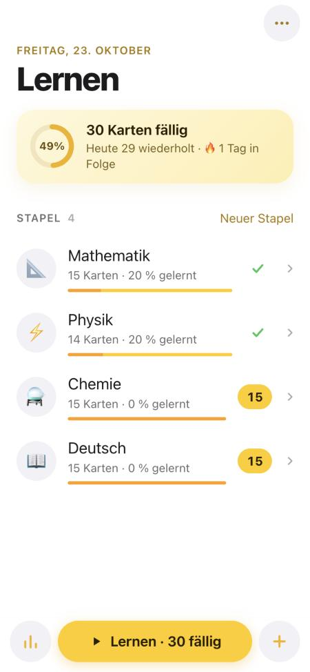
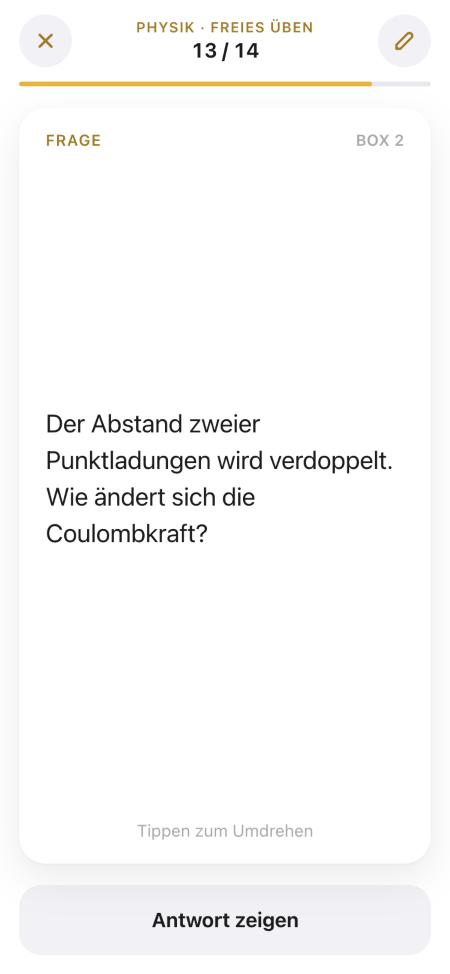
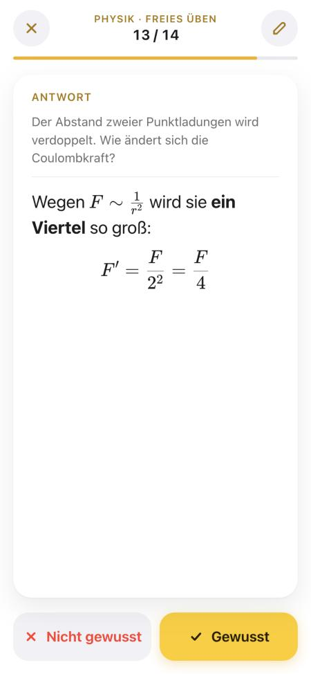
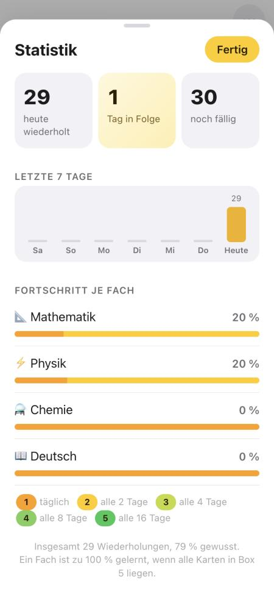
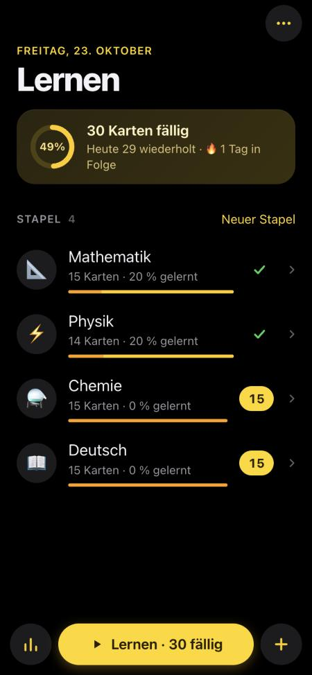

# Karteikarten

Lernkarten für das Studienkolleg (T-Kurs) mit dem Leitner-System. Ich benutze
die App auf dem iPhone, um Mathe, Physik, Chemie und Deutsch zu wiederholen.

**Live:** https://kharon2001.github.io/karteikarten/

| Start | Frage | Antwort | Statistik | Dunkel |
| --- | --- | --- | --- | --- |
|  |  |  |  |  |

## Funktionen

- Ein Stapel pro Fach, auf der Startseite steht, wie viele Karten heute dran sind
- Karte antippen zum Umdrehen, dann „Gewusst“ oder „Nicht gewusst“
- Leitner-System mit 5 Boxen
- Formeln mit KaTeX, z. B. `$f'(x) = 2x$` oder `$$n = \frac{m}{M}$$`
- Karten und Stapel anlegen, bearbeiten, löschen
- Statistik: heute wiederholt, Serie, letzte 7 Tage, Fortschritt pro Fach
- Export und Import als `.json`
- Heller und dunkler Modus
- Funktioniert offline, kein Konto, alle Daten bleiben auf dem Handy

## Aufbau des Repositorys

```
karteikarten/
├── index.html             Grundgerüst der Seite
├── styles.css             Design (hell/dunkel)
├── app.js                 Oberfläche und Abläufe
├── store.js               Speichern, Leitner-Logik, Statistik
├── seed.js                Startkarten für die vier Fächer
├── sw.js                  Service Worker (Offline-Cache)
├── manifest.webmanifest   Name, Icon, Vollbild auf dem Home-Bildschirm
├── icons/                 App-Icons
├── docs/                  Screenshots für dieses README
├── tools/
│   └── make_icons.py      erzeugt die PNG-Icons
└── vendor/katex/          KaTeX 0.16.11 mit Schriften (MIT-Lizenz)
```

Es gibt kein Framework und keinen Build-Schritt. Die Dateien werden direkt so
ausgeliefert, wie sie im Repository liegen.

### app.js

Alles, was man sieht:

- **Startseite:** Stapel, fällige Karten, Fortschrittsring
- **Stapel-Ansicht:** Verteilung auf die Boxen, Kartenliste
- **Editor:** Vorder- und Rückseite mit Live-Vorschau der Formeln
- **Wiederholung:** Vollbild, Karte umdrehen, bewerten
- **Statistik und Optionen:** Theme, Export/Import, Rückgängig

Fenster öffnen sich als Bottom Sheets, wie in iOS.

### store.js

- Speichert alles in IndexedDB, mit einer Kopie in `localStorage`.
- Beim Start wird die neuere der beiden Kopien geladen.
- Enthält die Leitner-Regeln und die Berechnung der Serie.

Datenmodell (vereinfacht):

```js
{
  decks: [{ id, name, emoji }],
  cards: [{ id, deckId, front, back, box, due }],   // due = "JJJJ-MM-TT"
  log:   { "2026-10-23": { n: 29, ok: 23 } },       // Wiederholungen pro Tag
  settings: { theme: "auto" }
}
```

### Leitner-System

| Box | 1 | 2 | 3 | 4 | 5 |
| --- | --- | --- | --- | --- | --- |
| nächste Wiederholung nach | 1 Tag | 2 Tagen | 4 Tagen | 8 Tagen | 16 Tagen |

- **Gewusst:** Die Karte rückt eine Box weiter.
- **Nicht gewusst:** Die Karte geht zurück in Box 1 und kommt in derselben
  Runde noch einmal.
- Nur die erste Antwort einer Runde zählt für die Box.

### Karten schreiben

- Formeln stehen zwischen `$…$`, zentrierte Formeln zwischen `$$…$$`.
- `**fett**` wird fett.
- Ein Zeilenumbruch bleibt ein Zeilenumbruch.
- Die Startkarten stehen in `seed.js` und werden nur beim allerersten Öffnen
  geladen.

## Lokal starten

```bash
python3 -m http.server 8000
```

Danach http://localhost:8000 öffnen. Wenn sich Dateien ändern, die `VERSION`
in `sw.js` hochzählen, sonst zeigt die installierte App noch die alte Version.

## Auf dem iPhone installieren

1. Link in Safari öffnen.
2. Teilen → Zum Home-Bildschirm → Hinzufügen.
3. Einmal mit Internet öffnen, danach geht es offline.

---

Entwickelt mit Unterstützung von [Claude Code](https://claude.com/claude-code).
